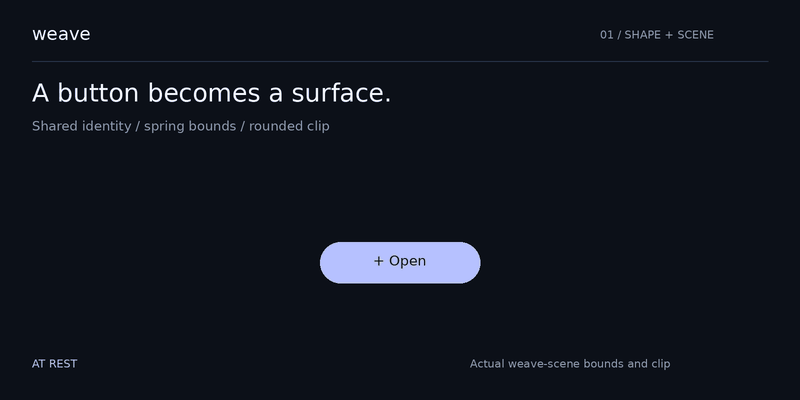
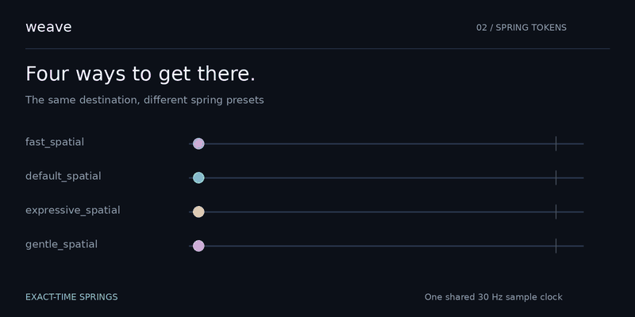
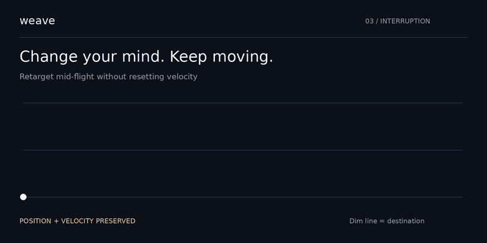

<div align="center">

# weave

### Motion that follows through.

Spring physics, shape morphing, and shared-element choreography for Rust.
<br>
Change the destination. Keep the momentum.

**Renderer independent** · **Interruption safe** · **`no_std` + `alloc`**

[See it move](#see-it-move) · [Get started](#get-started) · [Use it in your app](#use-it-in-your-app) · [Documentation](#documentation)

</div>

<br>



<div align="center">
<sub>Real engine samples, rendered as a documentation illustration. No GPU or browser required.</sub>
</div>

## See it move

### One surface, two states

The button above keeps its identity as its bounds and rounded clip change.
Layout supplies the destination; Weave produces the presentation state.
Text stays at a fixed size rather than stretching with the surface.

Try the terminal version and reverse it while it moves:

```sh
cargo run -p button-to-panel -- --interactive
```

Enter `p` to expand, `b` to collapse, `m` to toggle reduced motion, or `q` to quit.

### Choose the feel



Four presets, one destination. Fast feedback, everyday motion, a little
overshoot, or a quiet settle. These original presets are now superseded by
the motion-role scheme described in the [motion guide](docs/MOTION.md);
`MotionToken::role()` names each one's replacement.

```sh
cargo run -p spring-playground -- --interactive
```

Enter `1` or `0` to move, `p expressive_spatial` to change the preset,
`t 0.5` to choose a target, or `m` to toggle reduced motion.

### Interrupt without starting over



The dim line is the destination; the bright curve is the spring's position.
Changing the target preserves position and velocity. A reversal can keep
travelling briefly before turning around, just as momentum requires.

All three previews use deterministic samples from `weaver-motion` and
`weave-scene`. They illustrate the engine's output; they are not recordings
of the optional GPU or browser adapters.

<details>
<summary>Regenerate the animations</summary>

```sh
nix develop .#docs --command python tools/render_readme.py
```

The [sample exporter](crates/weave-scene/examples/readme_samples.rs) runs the
actual springs and scene at 30 Hz. The [renderer](tools/render_readme.py)
turns those values into the GIFs checked into `docs/assets/`.

</details>

## Get started

```sh
git clone https://github.com/maxmaster55/weave-engine.git
cd weave-engine
nix develop
cargo run -p button-to-panel -- --interactive
```

This repository is currently private; cloning requires an authorized GitHub
account. With an existing Rust toolchain, you can skip `nix develop`.

```sh
cargo build --workspace
cargo test --workspace
```

Running either terminal demo without `--interactive` prints its scripted
motion report. `make build`, `make test`, and `make check` are also available.

## Use it in your app

From a local checkout:

```toml
[dependencies]
weaver-motion = { path = "../weaver-motion/crates/weaver-motion" }
```

Or use the Git repository, with GitHub access configured:

```toml
[dependencies]
weaver-motion = { git = "https://github.com/maxmaster55/weave-engine.git" }
```

Pin a reviewed commit with Cargo's `rev` option for reproducible builds.
The crates are prepared for registry publishing, but this README does not
assume they have been published to crates.io.

```rust
use weaver_motion::{Spring, SpringConfig};

fn main() -> Result<(), weaver_motion::SpringError> {
    let config = SpringConfig::unit_mass(300.0, 0.8)?;
    let mut position = Spring::resting(0.0, config);

    position.set_target(100.0);
    position.advance(1.0 / 60.0); // elapsed seconds from your frame clock

    // Change your mind: position and velocity carry through.
    let velocity = position.velocity();
    position.set_target(0.0);
    assert_eq!(position.velocity(), velocity);

    // Present position.value(); request another frame while active.
    assert!(position.is_active());
    Ok(())
}
```

The solver uses a closed-form damped oscillator rather than numerical
integration. Physics follows elapsed time across different frame cadences.
Settled animations stop requesting frames through the scheduler; your
application controls its event loop.

### Motion roles and the motion guide

Pick springs by what changes, not by feel. [`docs/MOTION.md`](docs/MOTION.md)
is the theme-independent guide every product on Weave follows: roles,
durations, stagger, live-data rules, reduced motion and accessibility limits.

```rust
use weaver_motion::{MotionEngine, MotionPolicy, MotionRole, SpringConfig};

let mut engine = MotionEngine::with_policy(MotionPolicy::Reduced);
// Standard scheme by default; under Reduced, spatial roles lose their bounce
// but keep moving, and effects roles are unchanged.
let x = engine.spring_for_role("tile.x", 0.0, MotionRole::SpatialDefault);
engine.retarget(x, 240.0);

// Designer-facing parameters, Apple style.
let spring = SpringConfig::from_duration_bounce(0.5, 0.3).unwrap();
assert!((spring.overshoot() - 0.046).abs() < 0.001); // bounce is not overshoot
```

Also new: `perceptual_duration()`, `bounce()`, `overshoot()` and
`settle_time(ε)` on `SpringConfig`; per-unit settle thresholds
(`SETTLE_POSITION_PX`, `SETTLE_SCALE`, `SETTLE_OPACITY`, `SETTLE_COLOR`) with
`with_settle_threshold`; `MotionPolicy::spring_for_role` and
`prefers_crossfade(distance_px)`; and `stagger_delays(n)` for capped,
time-based entrance cascades.

For embedded or bare Wasm use, select `default-features = false` and
`features = ["libm"]`. The core requires `alloc`; renderer dependencies stay
optional. See the [portability guide](docs/PORTABILITY.md).

## Build only what you need

| Crate | Responsibility |
| :--- | :--- |
| [`weaver-motion`](crates/weaver-motion) | Exact-time springs, tweens, motion tokens, clock, scheduler, and motion policy |
| [`weave-geometry`](crates/weave-geometry) | Rounded rectangles, Bézier correspondence, validated morphs, and caching |
| [`weave-scene`](crates/weave-scene) | Stable identity, shared-element FLIP, bounds transitions, and choreography |
| [`weave-wgpu`](crates/weave-wgpu) | Draw lists and an optional GPU renderer (`wgpu` feature) |
| [`weave-web`](crates/weave-web) | CSS presentation and an optional DOM adapter (`web` feature) |

```text
state + layout → scene → spring / tween → presentation → your renderer
                            ↑
                   geometry + motion policy
```

Weave owns motion. Your application owns layout, input, rendering, and the
frame clock. Reduced and Off policies let applications adapt motion without
changing their semantic state.

## Documentation

| Start here | What you'll find |
| :--- | :--- |
| [Motion guide](docs/MOTION.md) | Roles, tokens, stagger, live data, reduced motion, accessibility limits, conversions |
| [Architecture](docs/ARCHITECTURE.md) | Layers, frame flow, and engineering decisions |
| [Portability & integration](docs/PORTABILITY.md) | Features, `no_std`, consuming the crates, and Nix |
| [Profiling](docs/PROFILING.md) | Recorded measurements and their limits |
| [Design](DESIGN.md) | Product direction and technical specification |
| [Implementation skill](SKILL.md) | Instructions for agents working with Weave |
| [Technical references](references/) | Physics, morphing, integration, and testing |
| [Changelog](CHANGELOG.md) | Release notes |

## Current boundaries

The portable core, geometry, scene, and terminal demos are implemented.
The optional GPU and web adapters have been compiled; execution on a GPU
or in a browser was not verified in the reference environment. The previews
above do not establish adapter performance or device frame rates.

Morphing supports compatible contours. Topology changes such as holes,
splits, or merges need a caller-provided fallback. Spring presets still
need perceptual tuning for each product and distance; the scheme roles
follow Material 3's published values and are the recommended starting point.

Weave takes inspiration from Material 3 Expressive motion concepts. It is
not a Google product or endorsement, and its presets are not official
Material tokens.

## License

[MIT](LICENSE-MIT) or [Apache-2.0](LICENSE-APACHE), at your option.
